<h2>TensorFlow-FlexUNet-Image-Segmentation-ProstateX-Cancer-MRI (2026/11/22)</h2>
Toshiyuki Arai 
Software Laboratory antillia.com  
This is the first experiment of Image Segmentation for <b>ProstateX-Cancer-MRI </b>
 based on
our <a href="https://github.com/sarah-antillia/TensorFlow-FlexUNet-Image-Segmentation-Model">TensorFlowFlexUNet Model</a>
 (<b>TensorFlow Flexible UNet Image Segmentation Model for Multiclass</b>) and a 384x384-pixel PNG
<a href="https://drive.google.com/file/d/1BoqKwdXhHow6FIdyhlWcGKSs3xYQP3Zs/view?usp=sharing">
<b>ProstateX-Cancer-MRI-ImageMask-Datasaet.zip</b></a>
 (<a href="https://www.mit.edu/~amini/LICENSE.md">MIT</a>
) derived  by us from the Kaggle
  
<a href="https://www.kaggle.com/datasets/ajithdari/prostatex-mri-image-and-mask-dataset">
<b>ProstateX MRI Image and Mask Dataset
</b>
</a> by Mukesh Dilip .
  

<b>Actual Image Segmentation for ProstateX-Cancer-MRI Images of 384x384 pixels</b> 
As shown below, the inferred masks resemble the ground-truth masks.  
 
 
<table>
<tr>
<th width="320" height="auto">Input: image</th>
<th width="320" height="auto">Mask (ground_truth)</th>
<th width="320" height="auto">Prediction: inferred_mask</th>
</tr>
<tr>
<td>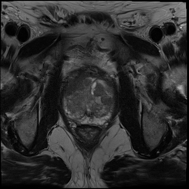</td>
<td></td>
<td></td>
</tr>
<tr>
<td>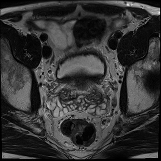</td>
<td></td>
<td></td>
</tr>
<tr>
<td>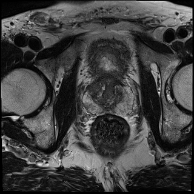</td>
<td></td>
<td></td>
</tr>
</table>

 
<h3>1. Dataset Citation</h3>
The dataset used here was derived from the following Kaggle:  

<a href="https://www.kaggle.com/datasets/ajithdari/prostatex-mri-image-and-mask-dataset">
<b>ProstateX MRI Image and Mask Dataset
</b>
</a>  
<b>3D Prostate MRI Images & Segmentation Masks in NIfTI Format</b>
 by Mukesh Dilip .

  
The following explanation was taken from the website above. 
  
<b>About Dataset</b> 
This dataset contains 3D prostate MRI images and their corresponding segmentation masks 
in NIfTI (.nii) format. It is organized at the patient level, with each MRI image paired 
with its respective mask.
  
A CSV metadata file is included with information such as Patient ID, image and mask 
filenames, image/mask shapes, voxel spacing, shape matching status, image intensity 
statistics, mask voxel count, and processing status.
  

<b>License</b> 
Unknown
 
 
<h3>
2. ProstateX-Cancer-MRI ImageMask Dataset
</h3>
<h3>2.1 Download ImageMask Dataset</h3>
 If you would like to train this ProstateX-Cancer-MRI Segmentation model,
 please download the dataset from the Google Drive 
<a href="https://drive.google.com/file/d/1BoqKwdXhHow6FIdyhlWcGKSs3xYQP3Zs/view?usp=sharing">
<b>ProstateX-Cancer-MRI-ImageMask-Datasaet.zip</b>.
</a> 
Expand the downloaded and put it under the <b>./dataset</b> folder.
 
<pre>
./dataset
└─ProstateX-Cancer-MRI
    ├─test
    │   ├─images
    │   └─masks
    ├─train
    │   ├─images
    │   └─masks
    └─valid
         ├─images
         └─masks
</pre>
 
<b>ProstateX-Cancer-MRI Statistics</b> 
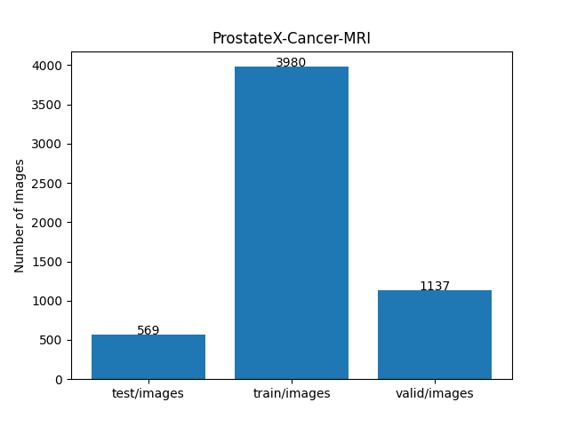 
 
As shown above, the number of images in the training and valid datasets is large enough to use for the
 training set of our segmentation model.
 
 
<h3>2.2 Train Sample Images and Masks</h3>
<b>Train_sample_images</b> 
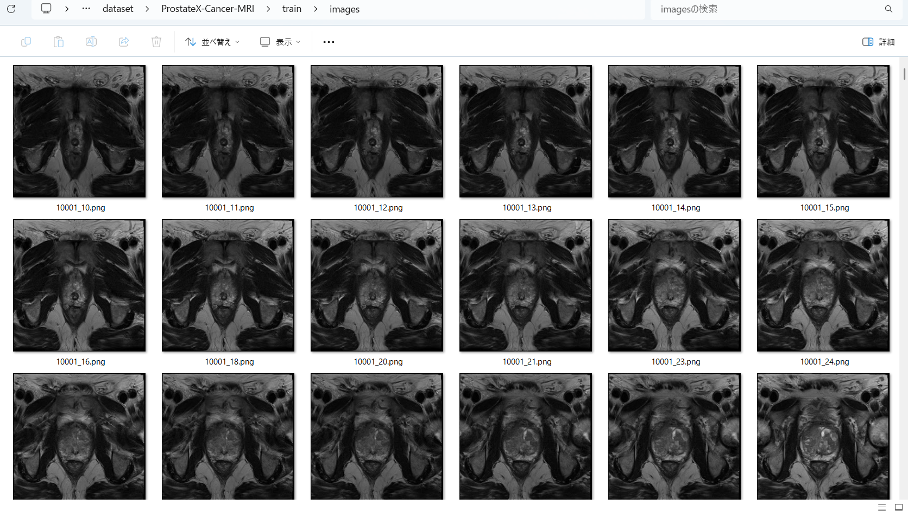
 
<b>Train_sample_masks</b> 
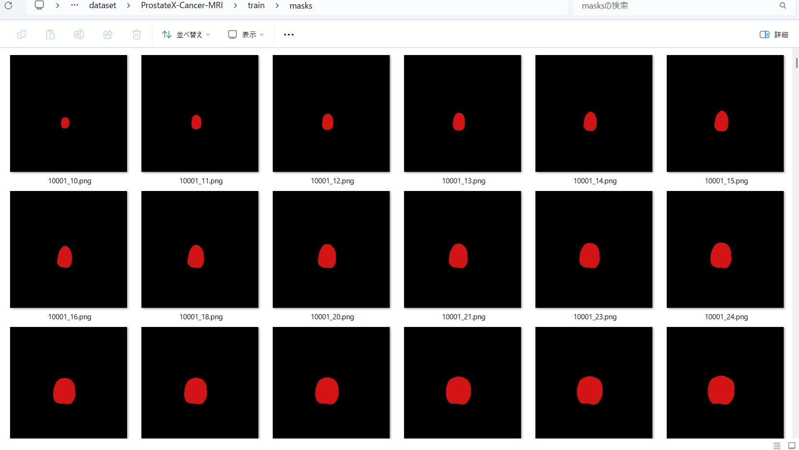
 
<h3>
3. Train TensorFlowFlexUNet Model
</h3>
 We trained the ProstateX-Cancer-MRI TensorFlowFlexUNet model using the following
<a href="./projects/TensorFlowFlexUNet/ProstateX-Cancer-MRI/train_eval_infer.config"> <b>train_eval_infer.config</b></a> file.  
Please move to ./projects/TensorFlowFlexUNet/ProstateX-Cancer-MRI and run the following bat file. 
<pre>
>1.train.bat
</pre>
This runs the following command. 
<pre>
>python ../../../src/TensorFlowFlexUNetTrainer.py ./train_eval_infer.config
</pre>

<b>Model parameters</b> 
Defined a small <b>base_filters=16 </b> and large <b>base_kernels=(11,11)</b> for the first Conv Layer of Encoder Block of 
<a href="./src/TensorFlowFlexUNet.py">TensorFlowFlexUNet.py</a> 
and a large <b>num_layers=8</b> (including a bridge between Encoder and Decoder Blocks).
<pre>
[model]
; You may specify your own UNet class derived from our TensorFlowFlexModel
model         = "TensorFlowFlexUNet"
generator     =  False
image_width    = 384
image_height   = 384
image_channels = 3
num_classes    = 2
base_filters   = 16
base_kernels   = (11,11)
num_layers     = 8
dropout_rate   = 0.05
dilation       = (1,1)
</pre>
<b>Learning rate</b> 
Defined a small learning rate.  
<pre>
[model]
learning_rate  = 0.00007
</pre>
<b>Loss and metrics functions</b> 
Specified "categorical_focal_dice_loss" and <a href="./src/dice_coef_multiclass.py">"dice_coef_hybrid"</a>. 
<pre>
[model]
loss           = "categorical_focal_dice_loss"
metrics        = ["dice_coef_hybrid"]
hybrid_alpha   = 1.4
hybrid_beta    = 0.6
</pre>
<b>Dataset class</b> 
Specified <a href="./src/ImageCategorizedMaskDataset.py">ImageCategorizedMaskDataset</a> class. 
<pre>
[dataset]
class_name    = "ImageCategorizedMaskDataset"
</pre>
 
<b>Learning rate reducer callback</b> 
Enabled the learning_rate_reducer callback and a small reducer_patience.
<pre> 
[train]
learning_rate_reducer = True
reducer_factor     = 0.4
reducer_patience   = 4
</pre>
<b>Early stopping callback</b> 
Enabled early stopping callback with the patience parameter.
<pre>
[train]
patience      = 10
</pre>
<b>RGB Color map</b> 
Specified RGB color map dict for ProstateX-Cancer-MRI 1+1 classes. 
<pre>
[mask]
mask_datatyoe    = "categorized"
mask_file_format = ".png"
;ProstateX-Cancer-MRI RGB color map dict for 1+1 classes.
; Background: black,  Cancer: dark_red
rgb_map = {(0,0,0):0,(210,20,20):1}
</pre>
<b>Epoch change inference callback</b> 
Enabled <a href="./src/EpochChangeInferencer.py">epoch_change_infer callback</a></b>. 
<pre>
[train]
epoch_change_infer       = True
epoch_change_infer_dir   =  "./epoch_change_infer"
num_infer_images         = 6
</pre>
By using this callback, on every epoch change, the inference procedure can be called
 for 6 images in the <b>mini_test</b> folder. This will help you confirm how the predicted mask changes 
 at each epoch during your training process.  
  
<!--
As shown below, early in the model training, the predicted masks from our FlexUNet segmentation model showed 
discouraging results.
 However, as training progressed through the epochs, the predictions gradually improved. 
   
 
-->
<b>Epoch_change_inference output at starting (epoch 1,2,3)</b> 
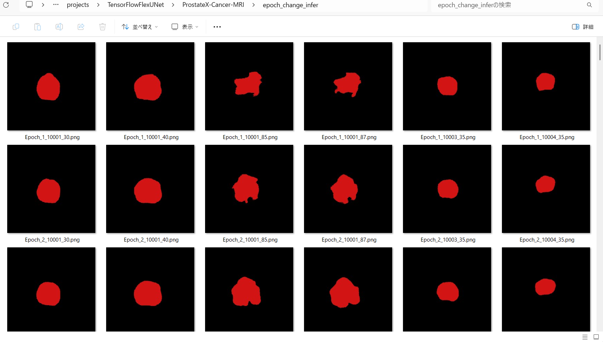 
 
<b>Epoch_change_inference output at middlepoint (epoch 23,24,25)</b> 
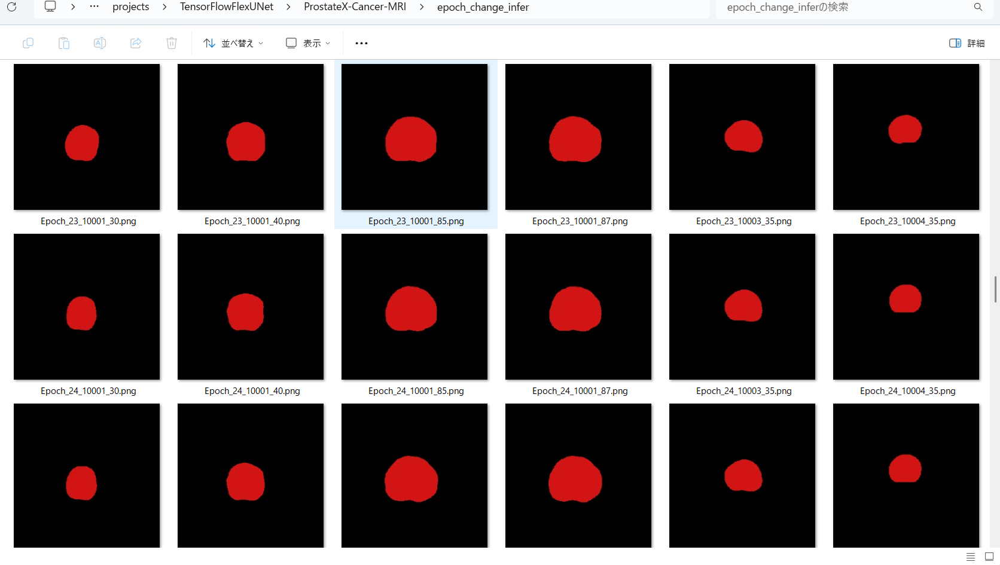 
 
<b>Epoch_change_inference output at ending (epoch 48,49,50)</b> 
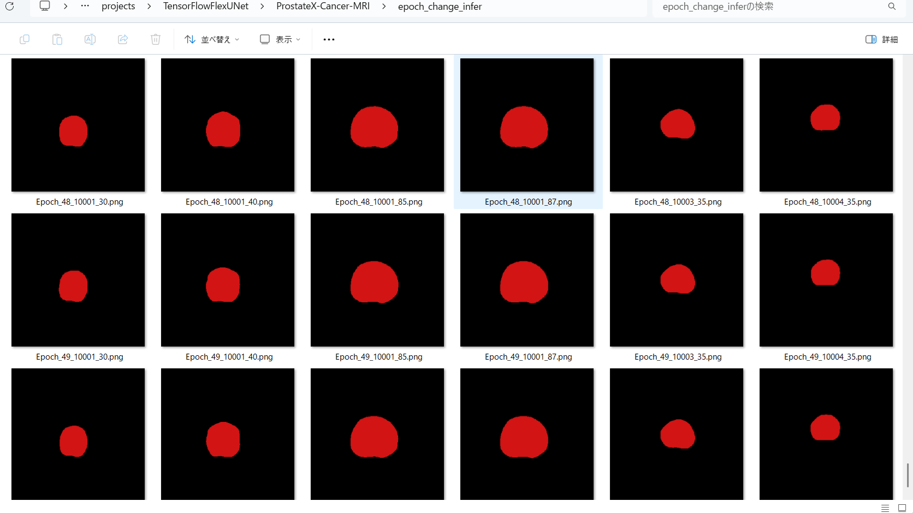 
 
In this experiment, the training process was terminated at epoch 50. 
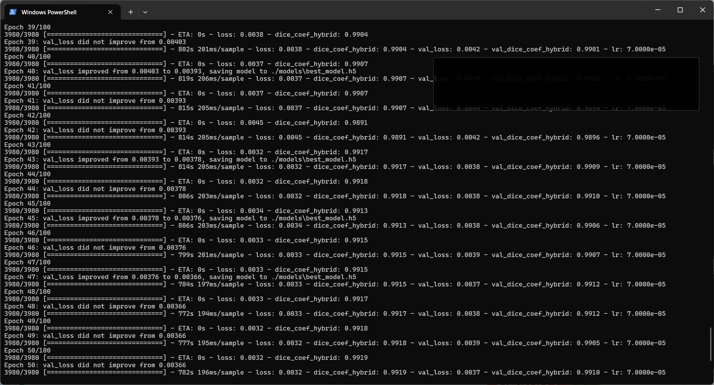 
 
<a href="./projects/TensorFlowFlexUNet/ProstateX-Cancer-MRI/eval/train_metrics.csv">train_metrics.csv</a> 
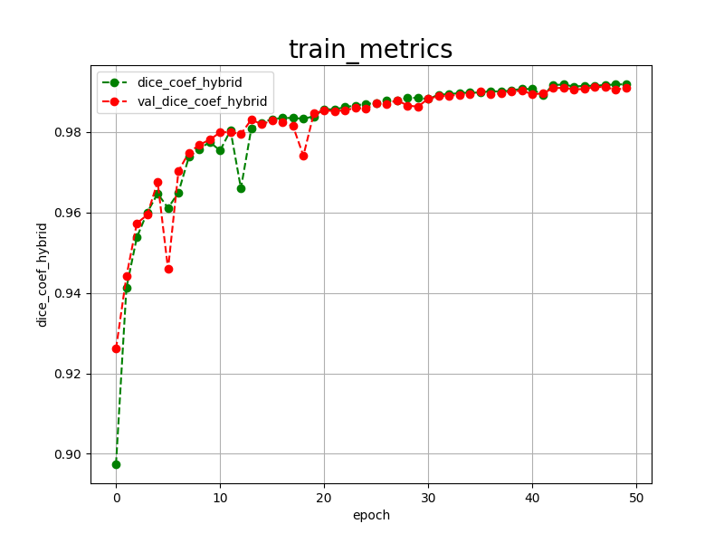 
 
<a href="./projects/TensorFlowFlexUNet/ProstateX-Cancer-MRI/eval/train_losses.csv">train_losses.csv</a> 
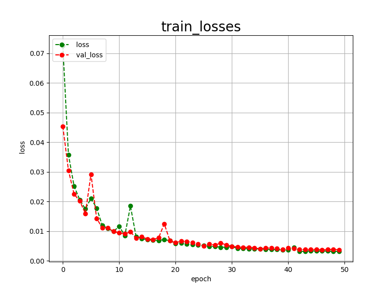 
 
<h3>
4. Evaluation
</h3>
Please move to <b>./projects/TensorFlowFlexUNet/ProstateX-Cancer-MRI</b> folder,
and run the following bat file to evaluate the TensorFlowUNet model for ProstateX-Cancer-MRI. 
<pre>
>./2.evaluate.bat
</pre>
This runs the following command.
<pre>
>python ../../../src/TensorFlowFlexUNetEvaluator.py ./train_eval_infer.config
</pre>
Evaluation console output: 
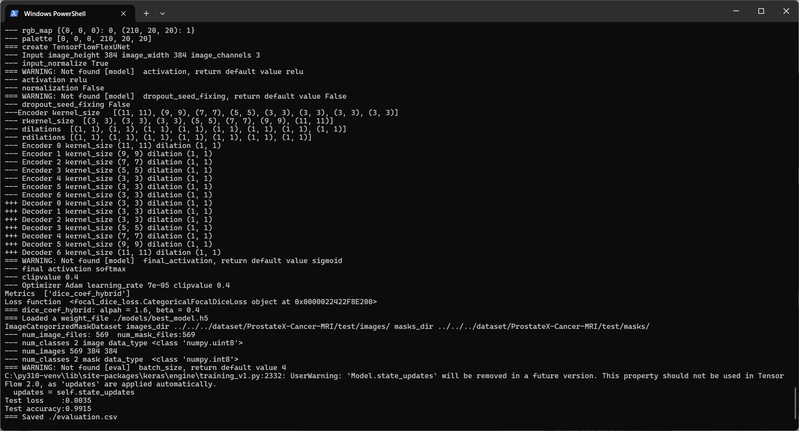
  Image-Segmentation-ProstateX-Cancer-MRI

<a href="./projects/TensorFlowFlexUNet/ProstateX-Cancer-MRI/evaluation.csv">evaluation.csv</a> 
The loss (categorical_focal_dice_loss) on this ProstateX-Cancer-MRI/test was very low, 
and dice_coef_hybrid was very high,
 as shown below.
 
<pre>
categorical_focal_dice_loss,0.0042
dice_coef_hybrid,0.9902
</pre>
 
<h3>
5. Inference
</h3>
Please move to <b>./projects/TensorFlowFlexUNet/ProstateX-Cancer-MRI</b> folder
and run the following bat file to infer segmentation regions for images using the trained TensorFlowUNet model for ProstateX-Cancer-MRI. 
<pre>
>./3.infer.bat
</pre>
This runs the following command.
<pre>
>python ../../../src/TensorFlowFlexUNetInferencer.py ./train_eval_infer.config
</pre>

<b>mini_test_images</b> 
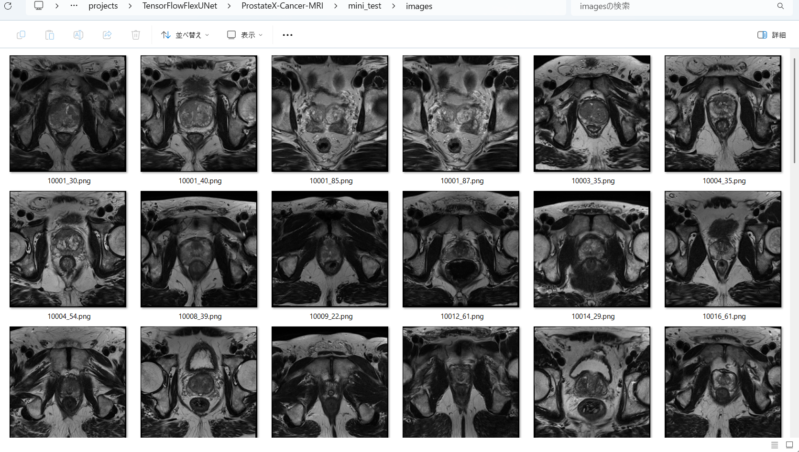 
<b>mini_test_mask(ground_truth)</b> 
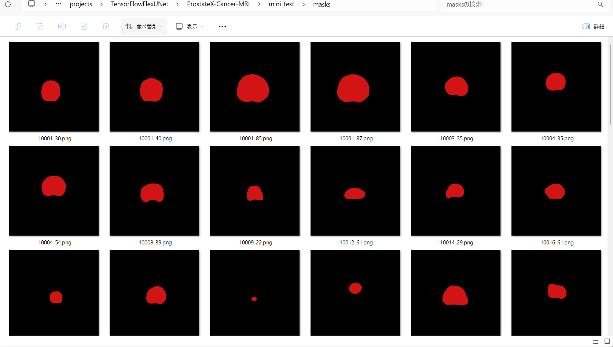 

<b>Inferred test masks</b> 
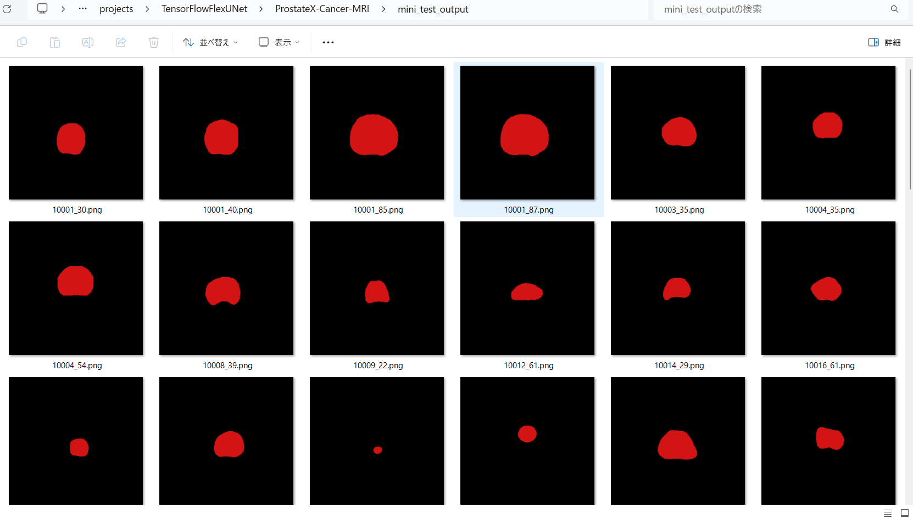 
 

<b>Enlarged images and masks for ProstateX-Cancer-MRI Images of 384x384 pixels</b> 
As shown below, the inferred masks look similar to the ground truth masks. 
  
<table>
<tr>
<th width="320" height="auto">Image</th>
<th width="320" height="auto">Mask (ground_truth)</th>
<th width="320" height="auto">Inferred-mask</th>
</tr>
<tr>
<td>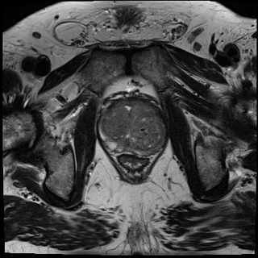</td>
<td></td>
<td></td>
</tr>
<tr>
<td>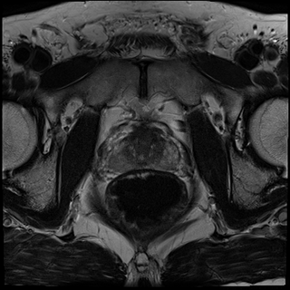</td>
<td></td>
<td></td>
</tr>
<tr>
<td>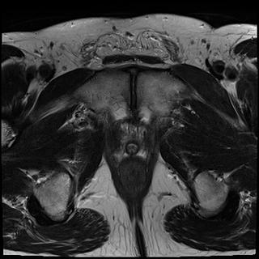</td>
<td></td>
<td></td>
</tr>
<tr>
<td>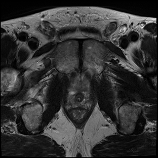</td>
<td></td>
<td></td>
</tr>
<tr>
<td>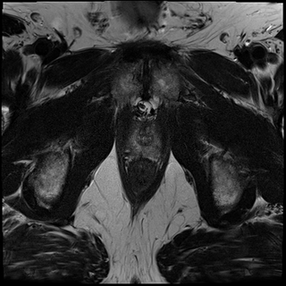</td>
<td></td>
<td></td>
</tr>
<tr>
<td>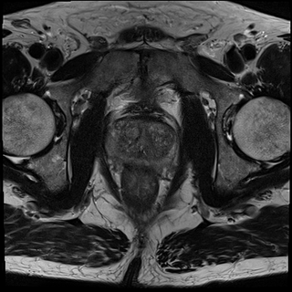</td>
<td></td>
<td></td>
</tr>
</table>

 

<h3>
6. 3D Volume Segmentation
</h3>
Please move to <b>./projects/TensorFlowFlexUNet/ProstateX-Cancer-MRI</b> folder
, and run the following bat file to infer images segmentation for 2D slices of 3D volume NIfTI files
 by the Trained-TensorFlowFlexUNet model for ProstateX-Cancer-MRI. 
<pre>
>./5.infer3d.bat
</pre>
This simply runs the following command.
<pre>
>python ../../../src/TensorFlowFlexUNet3DInferencer.py ./train_eval_infer.config
</pre>
<b>infer3d section </b> in <a href="./projects/TensorFlowFlexUNet/ProstateX-Cancer-MRI/train_eval_infer.config">
train_eval_infer.config
<a></b>
<pre>
[infer3d] 
;Specify an images_dir which contains NIfTI files
images_dir    = "./mini_test_3d/images/"
output_dir    = "./mini_test_3d_output/"
slice_shape_order = "hwd"
slice_normalize = True
slice_resize   = (384,384)
slice_rotation = "cv2.ROTATE_90_CLOCKWISE"
mask_overlay  = True
</pre>

<b>Acutual Image Segmentation for 2D Slices of a ProstateX-Cancer-MRI NIfTI</b> 
Some Slices, Inferred Masks and Mask overlays for a 3D volume <b>ProstateX-0070.nii</b> file in <b>ProstateX/image</b> 
folder. 
 
 
<table>
<tr>
<th>Image</th>
<th>Inferred-mask</th>
<th>Mask overlay</th>
</tr>

<tr>
<td></td>
<td></td>
<td>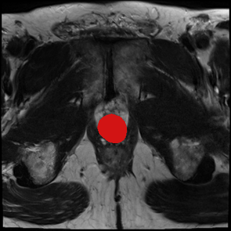</td>
</tr>

<tr>
<td>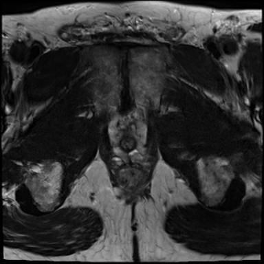</td>
<td></td>
<td>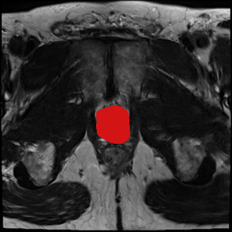</td>
</tr>
<tr>
<td>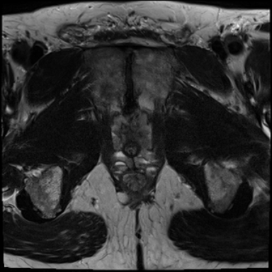</td>
<td></td>
<td>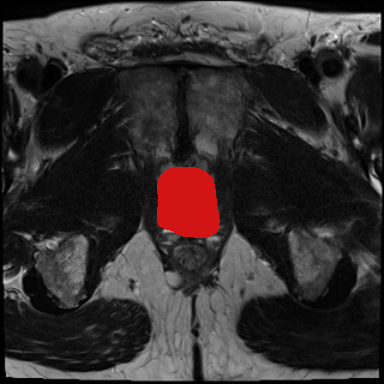</td>
</tr>
<tr>
<td>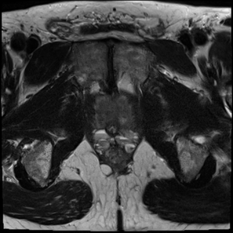</td>
<td></td>
<td>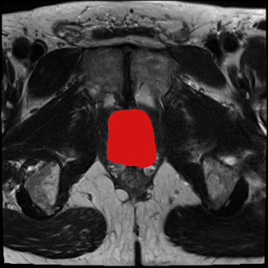</td>
</tr>
<tr>
<td>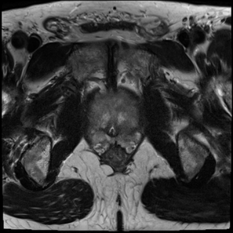</td>
<td></td>
<td>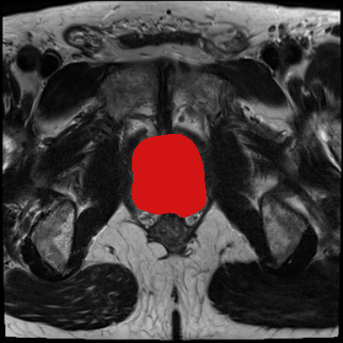</td>
</tr>
<tr>
<td>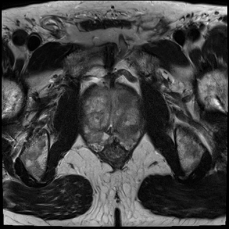</td>
<td></td>
<td>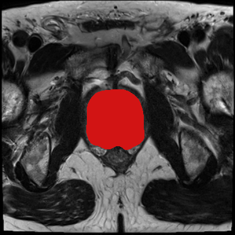</td>
</tr>
</table>

 
<h3>
7. MaskOverlay Video of 3D Volume Segmentation
</h3>
Please move to <b>./projects/TensorFlowFlexUNet/ProstateX-Cancer-MRI</b> folder, and run the following bat file 
to generate <b>overlays.mp4</b> or <b>overlay.gif</b> for MaskOverlays of 3D Volume Segmentation.  
<pre>
>./6.video3d.bat
</pre>
This simply runs the following command.
<pre>
>python ../../../src/MaskOverlayVideoGenerator.py ./train_eval_infer.config
</pre>
 
<b>infer3d section </b> in <a href="./projects/TensorFlowFlexUNet/ProstateX-Cancer-MRI/train_eval_infer.config">
train_eval_infer.config
<a></b>
<pre>
[infer3d] 
mask_overlay  = True
;Specify ".mp4" or ".gif".
;video_fileformat  = ".mp4"
video_fileformat  = ".gif"
</pre>
 
<b>overlays.gif</b> 
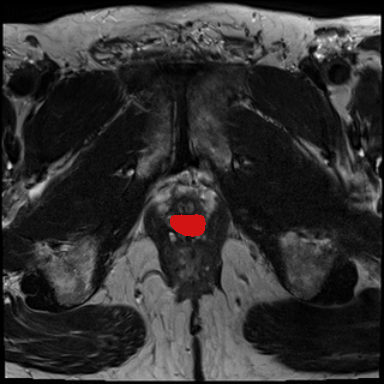
 
 
<h3>
References
</h3>
<b>1. Evaluation of prostate segmentation algorithms for MRI: The PROMISE12 challenge</b> 
Geert Litjens, Robert Toth, Wendy van de Ven, Caroline Hoeks, Sjoerd Kerkstra, Bram van Ginneken, 
Graham Vincent, Gwenael Guillard, Neil Birbeck, Jindang Zhang, Robin Strand, Filip Malmberg, 
Yangming Ou, Christos Davatzikos, Matthias Kirschner, Florian Jung, Jing Yuan, Wu Qiu, Qinquan Gao, 
Philip “Eddie” Edwards, Bianca Maan, Ferdinand van der Heijden, Soumya Ghose, Jhimli Mitra, 
Jason Dowling, Dean Barratt, Henkjan Huisman, Anant Madabhushi 
<a href="https://www.sciencedirect.com/science/article/abs/pii/S1361841513001734?via%3Dihub">
https://www.sciencedirect.com/science/article/abs/pii/S1361841513001734?via%3Dihub
</a>  
<b>2. TensorFlow-FlexUNet-Image-Segmentation-PROMISE12-Prostate-Cancer</b> 
Toshiyuki Arai 
<a href="https://github.com/sarah-antillia/TensorFlow-FlexUNet-Image-Segmentation-PROMISE12-Prostate-Cancer">
https://github.com/sarah-antillia/TensorFlow-FlexUNet-Image-Segmentation-PROMISE12-Prostate-Cancer
</a>
  
<b>3. TensorFlow-FlexUNet-Image-Segmentation-Transverse-Plane-Prostate-Cancer-MRI</b> 
Toshiyuki Arai 
<a href="https://github.com/sarah-antillia/TensorFlow-FlexUNet-Image-Segmentation-Transverse-Plane-Prostate-Cancer-MRI">
https://github.com/sarah-antillia/TensorFlow-FlexUNet-Image-Segmentation-Transverse-Plane-Prostate-Cancer-MRI
</a>
  
<b>4. TensrFlow-FlexUNet-Image-Segmentation-Model</b> 
Toshiyuki Arai 
<a href="https://github.com/sarah-antillia/TensorFlow-FlexUNet-Image-Segmentation-Model">
https://github.com/sarah-antillia/TensorFlow-FlexUNet-Image-Segmentation-Model
</a>
  
